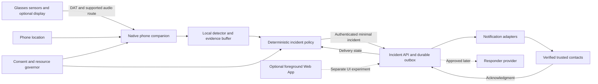
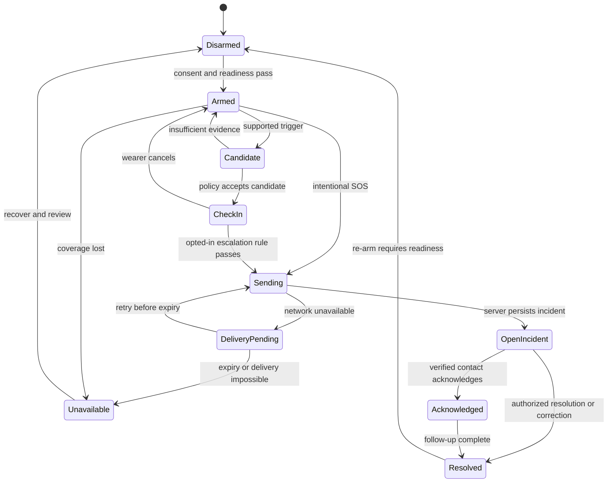

# Ray Guardian

**A proposed hands-free safety companion for Meta smart glasses.** Ray Guardian aims to recognize signs that help may be needed, check on the wearer when possible, and share an alert, location, and limited context with people the wearer has chosen.

**Status: early Android prototype with Nemotron AI context.** The app can register with Meta AI, display reported glasses status, rehearse a local simulated alert, and send explicitly submitted text and an optional selected image to Nemotron for a contextual summary. It does not detect emergencies, send contact alerts, share location, contact responders, or provide background protection. The product vision includes medical collapse, assault, and bystander emergencies; reliable detection of those events has not been demonstrated.

Reviewed **14 November 2026** against Meta's public documentation search service and the official repositories listed below. Values described as **proposed** are Ray Guardian design choices to test, not Meta specifications or measured performance.

## Run the Android prototype

The prototype is a foreground-only rehearsal, not an emergency service. The simulated device uses Meta's MockDeviceKit in debug builds; it does not simulate real monitoring or message delivery. Real-glasses registration uses the DAT core SDK; the app does not start a glasses sensor session or access the camera, microphone, or location.

**Requirements:** JDK 17+, Android SDK 36, an Android 12+ device or emulator, and internet access for the first Gradle dependency download. A real-glasses connection additionally requires supported Meta glasses paired in the Meta AI app, with Meta AI Developer Mode enabled. See [Meta's setup guide](https://wearables.developer.meta.com/docs/develop/dat/getting-started-toolkit/).

1. Open the repository in Android Studio, or set `ANDROID_HOME` to your Android SDK directory.
2. Run `./gradlew assembleDebug testDebugUnitTest` (Windows: `gradlew.bat assembleDebug testDebugUnitTest`).
3. Install `app/build/outputs/apk/debug/app-debug.apk` on a device or emulator, or run `./gradlew installDebug` with a connected device.
4. Select **Try simulated glasses** for Meta's debug mock device, or **Connect Meta glasses** to grant Bluetooth access and register through Meta AI. Force-stop and reopen the app to switch between the two modes. Once glasses are available, **Start device session** exercises a DAT session without starting sensor capture; leaving the screen stops the session.
5. Select **Start rehearsal**, then **Simulate SOS** or **Replay a possible incident**. A replayed incident starts a 15-second check-in; the SOS creates a simulated alert immediately. The incident screen contains an example location and a button to simulate a contact acknowledgment. Cancellation, acknowledgment, timeout, and finish are local state transitions. Leaving the screen stops an active rehearsal.

For a reproducible emulator check after building, run `python3 scripts/smoke_emulator.py --serial emulator-5554` with `adb` on `PATH` or `ANDROID_HOME` set. The script installs the debug app on the selected emulator, exercises the mock connection and rehearsal, and checks that leaving the foreground stops the rehearsal. It refuses physical-device serials.

To open the debug app directly in Meta's native simulated-glasses mode after installation, run `adb shell am start -W -n com.rayguardian.app/.MainActivity --ez ray_guardian_simulator true`. Force-stop the app first if it was already running in a different mode. This debug-only option enables MockDeviceKit; it does not start capture or send an alert. The Chrome Display simulator supports Web Apps, while this Android app uses DAT's MockDeviceKit.

For local Developer Mode, the build defaults the Meta application ID and client token to `0`. If your Meta project requires its own values, put `mwdat_application_id` and `mwdat_client_token` in the ignored `local.properties` file. Never commit credentials. The callback scheme is `rayguardian`; configure the matching scheme for your Meta integration. Production distribution and capability approval are separate from this debug build.

The prototype uses no camera or audio stream and requests no location, camera, or microphone permissions. The displayed battery and thermal values are reported DAT device metadata; they do not establish continuous coverage or a validated thermal operating envelope. SDK analytics and SDK crash-reporting opt-outs are configured in the manifest. The rehearsal transmits no contact, alert, media, or location. The separate Nemotron screen sends only the text and selected image you explicitly submit after confirming consent.

## Run Nemotron AI context

Nemotron is the prototype's AI provider. The Android app calls a small authenticated Node backend, which calls the supplied Verda container at `https://containers.datacrunch.io/nemotron-3-5-super-vl-b300/v1/chat/completions` with model `nemotron-3.5-super-vl`. This runtime integration uses the OpenAI-compatible protocol; OpenCode is not needed to run the app.

The **Verda inference key stays in the backend**, never in the APK or committed source. Local development credentials have been configured in ignored `server/.env` and `local.properties` files on the implementation machine. For a fresh checkout:

1. Install Node.js 22 or newer. The backend uses built-in modules and has no npm dependencies to install.
2. Copy `server/.env.example` to `server/.env`. Set `VERDA_INFERENCE_KEY` and a separate random `RAY_GUARDIAN_CLIENT_TOKEN` of at least 32 characters. Keep the default provider URL/model unless your deployment changes.
3. In ignored `local.properties`, set `ai_base_url=http://10.0.2.2:8787` and `ai_client_token` to the same **development client token**, not the Verda key.
4. Run `npm --prefix server start`. By default it listens only on `127.0.0.1:8787`.
5. Build/install the debug Android APK. Open **Open Nemotron context**, write a description, optionally choose an image, confirm submission consent, and select **Analyze with Nemotron**. An open simulated alert also offers **Review context with Nemotron**, which pre-fills only that rehearsal's synthetic context; it still requires consent and an explicit submission.

For a physical Android device connected by USB, use `adb reverse tcp:8787 tcp:8787`, change `ai_base_url` to `http://127.0.0.1:8787`, then rebuild/install. Debug HTTP exceptions are limited to emulator/loopback hosts. The release build disables this development connection and contains no client token. A deployed multi-user service will need HTTPS and proper per-user authentication; the development bearer token is not a production identity system.

**What Nemotron does:** returns a structured summary, reported/visible observations, and uncertainties. Text and images are treated as untrusted context. The model has no tools and cannot send, cancel, or acknowledge alerts, choose contacts, or claim dispatch. Its output is advisory and may be wrong; it is not a validated detector or medical assessment.

**Data and resource limits:** no automatic camera streaming or background inference; image selection uses Android's document picker. Selected images are resized to at most 768 pixels on the longest side and re-encoded as JPEG before upload, removing original metadata. The backend accepts at most 768 KiB of inline JPEG/PNG image data and 4000 description characters, permits two concurrent requests and ten analyses per minute, requests at most 1024 output tokens with thinking disabled, and times out provider calls after 40 seconds. There are no automatic paid retries. Leaving the AI screen cancels an active request. Raw context, image data, credentials, and model reasoning are not logged or persisted by this backend; provider processing and retention remain subject to Verda's terms and must be reviewed before real sensitive data is used.

Run backend tests with `npm --prefix server test`. Tests cover authorization, consent, vision payloads, bounded concurrency/rate, cancellation/timeout, malformed/truncated output, and sanitized provider errors. Live synthetic text and generated-image requests were verified against the supplied endpoint. [Verda API compatibility](https://docs.verda.com/inference/openai-compatibility/), [NVIDIA model card and thinking control](https://huggingface.co/nvidia/NVIDIA-Nemotron-3.5-Super-VL-120B-A12B-BF16)

To explicitly run a live Android AI smoke test, start the backend and run `python3 scripts/smoke_ai_emulator.py --serial emulator-5554 --live`. This sends one synthetic description through the app and may incur an inference charge. The normal rehearsal smoke test makes no AI requests.

The remaining README preserves the research and roadmap. Automatic detection, durable incident delivery, the full resource governor, real escalation, and production approval are future work.

## Smartwatch heart-rate screening

The main screen has a **Smartwatch heart rate** section that screens heart-rate readings while the app is in the foreground. It is a simple, unvalidated rule, not a medical assessment or arrhythmia detection.

- **Sources:** any watch or strap that exposes the standard Bluetooth LE Heart Rate service (`0x180D`), for example a watch in heart-rate broadcast mode, or one of four scripted simulated traces (resting, sustained high, sustained low, watch taken off). Connecting a real device asks for `BLUETOOTH_SCAN` (declared `neverForLocation`) and `BLUETOOTH_CONNECT`. Watches that only share data through a vendor app or Health Connect are not supported yet; a Wear OS companion is future work.
- **Rule:** a reading above 150 bpm or below 40 bpm that persists for at least 30 seconds and three readings is a candidate. Single spikes, readings outside 25–240 bpm, and readings the sensor flags as having no skin contact are ignored. Thresholds live in `HeartRateAnomalyDetector.Config` and are placeholders that need clinical review; they do not account for age, exercise, or medication.
- **Lost signal:** no reading for 15 seconds is shown as reduced coverage. It is never treated as an emergency.
- **Escalation:** if a rehearsal is active, a candidate starts the same 15-second check-in as a replayed incident, then a simulated alert. A candidate never creates an alert directly, and nothing is sent to contacts or emergency services. Leaving the screen disconnects the watch.

Readings are kept in memory only and are not logged, stored, or sent to the backend. The Nemotron review of a heart-rate alert includes only the one-line summary shown on the alert screen, and only when you submit it.

## Contents

- [Run the Android prototype](#run-the-android-prototype)
- [Run Nemotron AI context](#run-nemotron-ai-context)
- [Smartwatch heart-rate screening](#smartwatch-heart-rate-screening)
- [1. Recommendation and feasibility](#1-recommendation-and-feasibility)
- [2. Verified capabilities and limits](#2-verified-capabilities-and-limits)
- [3. Product scope and scenarios](#3-product-scope-and-scenarios)
- [4. Proposed architecture](#4-proposed-architecture)
- [5. Approvals and release gates](#5-approvals-and-release-gates)
- [6. Consent, permissions, and onboarding](#6-consent-permissions-and-onboarding)
- [7. Detection and AI policy](#7-detection-and-ai-policy)
- [8. Alert and escalation state machine](#8-alert-and-escalation-state-machine)
- [9. Heat, battery, and bandwidth](#9-heat-battery-and-bandwidth)
- [10. Background operation and recovery](#10-background-operation-and-recovery)
- [11. Location and emergency delivery](#11-location-and-emergency-delivery)
- [12. Privacy, security, and abuse prevention](#12-privacy-security-and-abuse-prevention)
- [13. Glasses experience and simulator plan](#13-glasses-experience-and-simulator-plan)
- [14. Proposed incident contract](#14-proposed-incident-contract)
- [15. Validation and acceptance criteria](#15-validation-and-acceptance-criteria)
- [16. Hazard register](#16-hazard-register)
- [17. Roadmap and prioritized backlog](#17-roadmap-and-prioritized-backlog)
- [18. Operations and cost planning](#18-operations-and-cost-planning)
- [19. Decisions and questions to resolve](#19-decisions-and-questions-to-resolve)
- [20. Source register and review notes](#20-source-register-and-review-notes)

## 1. Recommendation and feasibility

Use a **native phone companion with the Device Access Toolkit (DAT)** as the main architecture. Keep capture and display work on the glasses small; run detection and the escalation policy on the paired phone; use a backend for durable incident delivery and recipient access. An optional Web App can explore the Display user experience, but it cannot supply camera or microphone capture. [Meta framework comparison](https://wearables.developer.meta.com/llms.txt)

Start with **one phone OS and one physical glasses model**. Android is the provisional first target, subject to the team's available hardware and a background-operation feasibility study. Keep iOS as a later, separately validated path. This recommendation does not establish that Android production distribution is approved.

The largest feasibility constraints are:

1. **The full automatic-detection vision depends on experimental capabilities.** DAT 1.0 marks motion, Inputs, on-device Speech, voice invocation, standalone photo capture, and camera-stream audio as experimental; apps using experimental features cannot currently be published to production channels. A development demonstration or permitted beta is a different release category. [Android changelog](https://github.com/meta/meta-wearables-dat-android/blob/f4371bc9f90249d51eb07d7f8a61e8d829294f16/CHANGELOG.md), [iOS changelog](https://github.com/meta/meta-wearables-dat-ios/blob/bbae597cd1c748cd29b9375a1624a8d75b1c9e14/CHANGELOG.md)
2. **Hands-free use is conditional on prior setup and current availability.** Registration, permissions, contacts, and arming happen before an emergency. A paused session, dead phone, disconnected glasses, or revoked permission can remove coverage. Only one DAT session runs on a device at a time. [Integration overview](https://wearables.developer.meta.com/docs/develop/dat/build-overview/), [Session lifecycle](https://wearables.developer.meta.com/docs/develop/dat/lifecycle-events/)
3. **This cannot be designed as continuous high-resolution video analysis.** Begin with camera-off standby and short capture windows after a supported trigger. If no usable trigger can run within the battery, policy, and OS constraints, automatic monitoring remains unavailable. A low-power architecture must not be marketed as detecting events it cannot observe.
4. **Direct responder dispatch is a separate integration.** The initial external recipient is an opted-in trusted contact. Do not assume a public API can dispatch police or an ambulance, or that an SMS or live link reaches a dispatcher. [National 911 Program guidance](https://www.911.gov/calling-911/)
5. **Production permission and medical positioning are unresolved.** The complete binding Meta terms and acceptable-use policy require a signed-in review. The iOS integration guide retrieved during this review explicitly warns that App Store publishing is unsupported; confirm its current applicability with Meta before planning an iOS launch. [Meta acceptable-use guidance](https://wearables.developer.meta.com/docs/develop/dat/acceptable-use/), [iOS integration prerequisites](https://wearables.developer.meta.com/docs/develop/dat/build-integration-ios/)

**First demonstration target:** a clearly labeled, supervised development build that is explicitly armed, accepts a supported manual/voice activation or a replayed sensor trigger, and creates a simulated incident with synthetic location and recipient acknowledgments. The current prototype supports phone controls and replay; glasses voice activation remains future work. A replayed candidate includes a short check-in; an intentional SOS goes directly to a simulated alert. Real delivery to consenting test contacts can follow in an approved pilot. No demonstration should contact emergency services.

## 2. Verified capabilities and limits

The official DAT repository READMEs identify package **1.0.1**; Meta's documentation search reports the **v1.0** reference corpus. Pin the package and record firmware, Meta AI app version, phone OS, and capability flags together. A package version alone is insufficient. [Version dependencies](https://wearables.developer.meta.com/docs/develop/dat/version-dependencies/)

| Need | Documentation finding | Planning consequence |
| --- | --- | --- |
| Camera video | DAT provides camera streaming through a started `DeviceSession`, an attached `Camera`, and `camera.stream`. | Use DAT; isolate the adapter from detection logic. Do not copy older `addStream` examples. |
| Capture in a Web App | Only DAT can use the glasses camera or capture microphone audio. | A Web App alone cannot implement the proposed audiovisual safety layer. |
| Motion | DAT Motion is experimental, with development/beta availability and no production publication yet. | Fall-like movement detection is research scope until availability and validity are established. |
| Ambient sound versus wearer voice | Bluetooth HFP is optimized for the wearer's voice and suppresses surrounding sound. Camera-stream audio includes ambient sound but is beta-only. | A voice SOS and a bystander distress detector require different evidence and testing. |
| Speech and voice launch | DAT Speech and voice invocations are experimental. Documented launch is “Hey Meta, start {app name}.” | Do not promise an arbitrary global wake phrase or unrestricted background listening. |
| Voice in a Web App | WebMCP tools are available to Meta AI while the page is open; WebMCP is off by default and depends on device eligibility. | Feature-detect and retain manual controls. It is not an always-on emergency listener. |
| Location | Web geolocation is normally supplied through the paired phone; glasses have no standalone satellite-navigation receiver. | Use phone location with timestamp and accuracy. The product is phone-dependent. |
| Heat and battery | DAT exposes device thermal level, battery, wear state, and hinge state. Streaming can fail on heat, low battery, or peak power. | Implement a resource governor and explicit unavailable states. |
| Display | Web Apps target Meta Ray-Ban Display; DAT also provides native Display capability. Ordinary Ray-Ban Meta glasses do not provide this display surface. | Support audio/phone fallback and test each hardware model separately. |
| Session coexistence | Another experience or system action can pause or end the DAT session. | Do not assume the detector, Web App, Meta AI, calls, and media all run concurrently. |
| Simulator | The Chrome extension previews the display and interactions. DAT MockDeviceKit supports native capability/state testing. | Use both, followed by physical device tests. Neither proves field detection or thermal safety. |

Sources: [DAT camera guide](https://github.com/meta/meta-wearables-dat-android/blob/f4371bc9f90249d51eb07d7f8a61e8d829294f16/plugins/mwdat-android/skills/camera-streaming/SKILL.md), [Motion guide](https://wearables.developer.meta.com/docs/develop/dat/motion/), [Microphones and speakers](https://wearables.developer.meta.com/docs/develop/dat/microphones-and-speakers/), [Voice invocations](https://wearables.developer.meta.com/docs/develop/dat/voice-invocations/), [WebMCP](https://wearables.developer.meta.com/docs/develop/webapps/agent-tools/), [Web device guidance](https://github.com/meta/meta-wearables-webapp/blob/fbf132997d036548ce090761a8bd4cf0afbda52a/plugins/meta-wearables-webapp/skills/ai-glasses-webapp-device/SKILL.md), [Device state](https://wearables.developer.meta.com/docs/develop/dat/device-state/), [Web App toolkit and simulator](https://github.com/meta/meta-wearables-webapp/blob/fbf132997d036548ce090761a8bd4cf0afbda52a/README.md).

### What the documentation does not establish

- Reliable medical-collapse, assault, or bystander-crisis detection; access to a medically validated vital sign is not established by these sources.
- Uninterrupted all-day background sensing, automatic restart after force-quit, or a universal session-duration guarantee.
- A safe temperature in degrees Celsius, a guaranteed hours-per-charge budget, or a universally safe camera duty cycle.
- Approval of Ray Guardian's intended use, an approved emergency dispatch interface, or a production exemption for experimental APIs.
- Silent recording, disabling capture indicators, or circumventing permission and OS restrictions.

## 3. Product scope and scenarios

| Scenario | Candidate signals to investigate | Initial behavior | Important limitation |
| --- | --- | --- | --- |
| Wearer requests help | Explicit SOS in an armed session; supported speech or UI action. | Create an incident immediately, then enrich with available location/context. | Voice launch support is experimental; noisy or unavailable input needs a fallback. |
| Possible wearer collapse | Fall-like motion plus subsequent inactivity and other available evidence. | Research detector prompts a check-in; opted-in policy may alert contacts if evidence persists and the wearer does not respond. | Glasses can fall off without a person collapsing. Motion is experimental and is not a diagnosis. |
| Possible assault | Wearer SOS, or a research combination of distress cues and motion. | Prioritize intentional SOS; evaluate automatic cues in shadow mode. | Shouts, sport, recordings, and arguments can resemble danger. No identity or intent inference. |
| Bystander crisis | Wearer explicitly asks for help for someone nearby; optional short contextual capture. | Share a minimal incident with the selected contact or later approved responder service. | Wearer's contacts are not automatically the bystander's emergency contacts; broad autonomous surveillance is out of scope. |
| Sensor/session failure | Stale input, removed glasses, permission loss, disconnection, heat. | Show reduced coverage or unavailable; preserve an already-open incident on the phone. | Failure alone must not be treated as proof of an emergency. |

### Release boundaries

| Stage | Included | Exit condition |
| --- | --- | --- |
| Controlled demo | Synthetic/replayed events, simulator, mock recipients, supervised on-device experiments. | Reproducible incident lifecycle and honest capability labels. |
| Opt-in beta | Verified test contacts; bounded armed sessions; permitted experimental features; initially shadow-mode detection. | Written pilot approval, consent, incident handling, thermal evidence, and agreed performance thresholds. |
| Production candidate | Supported APIs only, reviewed intended use, validated monitoring envelope, approved delivery channels and operational support. | Applicable G0–G5 gates have evidence; G6 is required only for responder integration. |
| Responder integration | Contracted/authorized service in a specific geography with a tested incident handoff. | Provider and local requirements satisfied; delivery and dispatch acknowledgments have defined meanings. |

Exclude diagnostic labels, treatment advice generated by a model, facial recognition, tracking alleged attackers, emotion/personality profiling, covert monitoring, and promises that responders have been dispatched without their confirmation. Medical features would require a separate intended-use and regulatory decision.

## 4. Proposed architecture

**Glasses:** provide supported inputs and brief status/cancel interactions. Keep the camera off in standby. Do not run a large generative model, continuous visual analysis, or a persistent animated dashboard on the glasses.

**Phone:** own arming, device/permission state, timestamp alignment, optional voice processing, lightweight detection, location, the incident state machine, an encrypted short-lived outbox, and capture limits. Keep manual SOS independent of cloud AI availability. DAT on iOS or Android runs as a phone integration, not as arbitrary native code installed by this project on the glasses. [Framework comparison](https://wearables.developer.meta.com/llms.txt)

**Backend:** authenticate devices/users, persist versioned incidents, deduplicate notifications, enforce recipient access and expiry, ingest signed provider callbacks, and record delivery/acknowledgment transitions. Send metadata before media. A queue or provider acceptance is not proof a person received help.

**AI service:** the current Nemotron prototype summarizes explicitly submitted text and a selected image through a backend. Automatic incident-clip analysis remains future work. The service cannot select recipients, change consent, invent location, cancel an incident, or directly dispatch responders. Its failure stays outside the alert rehearsal.

**Optional Web App:** explore status, check-in, and contact acknowledgment UX for Display glasses. Do not assume it can control a concurrent DAT session or silently communicate with a native companion. Any bridge requires a separate feasibility and authentication design. Prefer native DAT Display for a single-session companion if the approved capability set supports it.

Proposed future module boundaries: device adapter, audio adapter, location adapter, consent store, sensor-quality monitor, resource governor, detector, incident policy, delivery client, recipient service, and audit service. These are planning boundaries; no scaffolding is created by this change.

## 5. Approvals and release gates

There are separate decisions for **platform access**, **data permissions**, **automatic escalation**, and **public distribution**. A camera permission does not authorize location sharing, cloud processing, or contacting responders.

| Gate | Accountable role to assign | Evidence required before proceeding |
| --- | --- | --- |
| G0 — Intended use | Product lead + safety lead | Exact claims, target population, launch country, supported hardware, covered scenarios, and explicit exclusions. |
| G1 — Meta platform suitability | Platform lead + legal reviewer | Full signed-in review of Developer Terms and Acceptable Use Policy; written clarification from Meta where emergency/high-stakes use or monitoring is ambiguous; current API and release-channel eligibility. |
| G2 — Project and capability setup | Platform lead | Developer organization/project/integration; stable bundle/package identity; permission justifications; configured callbacks and applicable attestation; recorded device/software compatibility. |
| G3 — Pilot consent and privacy | Privacy lead + pilot owner | Data map, lawful-basis review for target jurisdiction, bystander handling, impact assessment where required, retention/deletion policy, consent text, verified recipients, approved staged test protocol. |
| G4 — Device and model safety | Engineering + independent safety reviewer | Thermal/battery traces, lifecycle failure tests, detector evaluation, cancellation usability, delivery fault tests, and signed acceptance thresholds. |
| G5 — Distribution | Release owner | Meta review and supported channel; separate Apple/Google distribution requirements; privacy disclosures; permissions/background-service compliance; support and rollback readiness. |
| G6 — Responder service | Partnerships lead + legal + safety | Named geography/provider, authorized interface, operating agreement, accepted payload, availability/fallback behavior, dispatch acknowledgment semantics, and supervised provider-approved test procedure. |

Meta requires capability justifications in the project's Permissions tab; those explanations are for internal review and do not replace end-user disclosures. Developer Mode supports unpublished integration testing. The documented Beta release channel is private and invitation-based; tester limits must be checked in the portal. [Project permissions](https://wearables.developer.meta.com/docs/develop/dat/manage-projects/), [Getting started](https://wearables.developer.meta.com/docs/develop/dat/getting-started-toolkit/), [Release channels](https://wearables.developer.meta.com/docs/develop/dat/set-up-release-channels/)

**Publishing blockers to resolve explicitly:** experimental capabilities cannot be production dependencies under the reviewed DAT guidance. The retrieved iOS integration guide also warns about App Store rejection related to ExternalAccessory/MFi and privacy-manifest requirements. That guide may evolve independently from SDK changelogs; obtain current confirmation for the exact build. Do not interpret beta access, an SDK version number, or local installation as public-release approval. [DAT publication restriction](https://github.com/meta/meta-wearables-dat-ios/blob/bbae597cd1c748cd29b9375a1624a8d75b1c9e14/CHANGELOG.md), [iOS prerequisites](https://wearables.developer.meta.com/docs/develop/dat/build-integration-ios/)

For an EU launch, assess health-data handling, relevant GDPR obligations, and whether the intended medical functionality makes the software a medical device. For a US launch, assess the specific software function under FDA guidance. These are review tasks, not a claim that this README determines classification or grants an exemption. Describing the app as “wellness” does not resolve what it actually does. [European Commission data guidance](https://commission.europa.eu/law/law-topic/data-protection/information-business-and-organisations/legal-grounds-processing-data_en), [EU software qualification guidance](https://health.ec.europa.eu/medical-devices-sector/new-regulations/guidance-mdcg-endorsed-documents-and-other-guidance_en), [FDA software-function guidance](https://www.fda.gov/medical-devices/digital-health-center-excellence/device-software-functions-including-mobile-medical-applications)

### Draft permission rationales for review

| Access | Proposed rationale | Limitation to state |
| --- | --- | --- |
| Glasses camera | Capture a short contextual window after a user SOS or an opted-in candidate event during an armed session. | No continuous standby video; no biometric identification; alert delivery does not wait for an image. |
| Audio | Recognize intentional wearer commands in a supported active mode; test ambient cues only through an allowed capture path. | HFP and camera audio differ; no covert recording; experimental features remain development/beta only. |
| Motion | Evaluate fall-like movement locally during opted-in research sessions. | Experimental; no medical conclusion from a motion threshold. |
| Location | Share incident location with verified recipients and provide limited updates while the incident remains open. | No continuous recipient tracking outside an incident; show time and accuracy. |
| Background operation | Continue a user-started, visible armed session and deliver an already-created incident where OS rules permit. | No workaround for force-quit, restricted background starts, or revoked access. |

## 6. Consent, permissions, and onboarding

Complete setup while the wearer can use the phone. No emergency flow should discover for the first time that a phone unlock, registration, contact verification, or permission grant is required.

1. Explain the supported use, failure modes, phone/network dependency, and coverage window in plain language.
2. Register the integration through Meta AI, then request only the needed device capabilities. Registration and capability grants are separate; camera permission can be temporary or persistent. Recheck effective state before each armed session. [Permissions flow](https://wearables.developer.meta.com/docs/develop/dat/permissions-requests/)
3. Request phone Bluetooth, microphone, location, notifications, and any justified background access through the relevant OS flows. HFP microphone permission is an OS permission; DAT Speech has its own documented microphone requirement. Motion/device metadata have no equivalent user-facing DAT permission value, so obtain product-level consent even where the SDK has no prompt. [Integration lifecycle](https://wearables.developer.meta.com/docs/develop/dat/build-overview/), [Motion prerequisites](https://wearables.developer.meta.com/docs/develop/dat/motion/)
4. Add trusted contacts, verify contact endpoints, obtain their opt-in, and send a clearly labeled test only as part of an authorized pilot. Let contacts decline or revoke participation. Never upload the whole address book by default.
5. Offer separate choices for local sensing, automatic trusted-contact escalation, media sharing, cloud analysis, and any future responder service. Default optional media and cloud processing off. Define a useful reduced mode when an optional permission is denied.
6. Explain and rehearse “send help,” “cancel,” “stop sharing,” and “stop monitoring” as distinct actions. A wearable gesture that stops a DAT session must not silently cancel an existing alert.
7. Show a readiness result: actual connected hardware, fresh required sensors, permissions, battery/heat status, location availability, verified contacts, and delivery connectivity. “Ready” must name the supported mode rather than imply universal protection.
8. Require an explicit **Arm** action for a bounded session. Provide a visible persistent monitoring state, an expiry, and an easy **Disarm** action. Proposed initial sessions last 15 minutes for supervised testing; extension and longer use require measurements.

**Proposed preauthorization:** the wearer can permit automatic notification to named contacts if a validated candidate persists through a check-in window. This consent is versioned and revocable. It is not blanket consent for bystanders, continuous cloud recording, or emergency-service dispatch. Do not request a new phone interaction at the moment the wearer may be incapacitated.

**Cancellation:** provide a large local cancel action and a supported voice alternative. Do not rely on a spoken phrase as strong identity authentication. Test accidental cancellation and cancellation by a nearby person; do not introduce speaker biometrics without a separate design and consent review. A canceled incident already sent requires a correction to the same recipients, not deletion of the fact that an alert occurred.

**Assault-sensitive behavior:** audible check-ins can expose the wearer or escalate a situation. Research a preselected discreet interaction mode with specialists and consenting participants. It must still honor platform recording indicators and disclosure requirements. Do not promise a hidden or undetectable mode.

## 7. Detection and AI policy

Use a staged cascade rather than asking a large model to decide whether every moment is dangerous:

1. **Quality and availability check:** validate sensor source, units, timestamps, wear state, freshness, and permission. Missing input means unknown coverage, not “safe.”
2. **Cheap candidate generation:** an intentional SOS, or research rules/lightweight models over a bounded motion/audio window. Camera remains off until a supported trigger justifies it.
3. **Short verification:** combine available independent cues, movement after the event, and an optional wearer response. Apply a resource budget before enabling camera or higher-rate sensing.
4. **Deterministic policy:** decide whether to check in, alert contacts under existing consent, or remain in shadow mode. Keep policy thresholds and model versions auditable.
5. **Optional context summarization:** describe observations and uncertainty. Do not delay the basic alert for cloud inference, video upload, reverse geocoding, or fresh GPS.

**Initial automatic detectors run in shadow mode:** they produce a research event but no external alert. Promotion requires a held-out evaluation and explicit pilot authorization. Intentional SOS uses a separate direct path.

| Signal | Useful research question | Confounders and safeguards |
| --- | --- | --- |
| Motion | Can a short sequence distinguish a wearer falling from ordinary movement? | Sitting quickly, sport, taking glasses off, dropping them, vehicles; test on non-injurious replay/staged movements and inspect wear state. |
| Wearer speech | Can an armed app recognize an intentional help request reliably? | Accent, speech impairment, wind, music, recorded phrases, multiple speakers, routing changes; provide manual fallback. |
| Ambient audio | Does a permitted audio path contain useful distress cues? | HFP suppresses ambient voices; beta camera audio costs power; no claim that either can reliably infer assault. |
| Video context | Can a small number of frames add factual context after activation? | Low light, motion blur, camera pointing away, occlusion, model hallucination; allow “unclear” and absent media. |
| Nonresponse | Does a timed check-in add useful evidence? | Distraction, deafness, unavailable UI, intimidation, session interruption; never equate silence alone with medical collapse. |

Do not infer a specific diagnosis, identify a perpetrator, infer intent from appearance, or assign a health risk from protected traits. Separate wearer and bystander scenarios in datasets and reporting. A model score is not a calibrated probability of an emergency unless calibration has been demonstrated.

Use participants and source sessions that do not overlap between training and evaluation. Document data rights, annotation disagreement, event definitions, model limitations, language coverage, and failure examples. Measure false alerts per armed hour as well as sensitivity by scenario. A balanced demo dataset cannot establish real-world performance for rare emergencies.

## 8. Alert and escalation state machine

Coverage state and incident state are independent. Device disconnection must not erase an open incident; a backend acknowledgment must not claim sensor coverage is healthy. The diagram summarizes the user-facing flow; implementation needs a complete transition table and persistent recovery rules. A supported intentional SOS can bypass candidate/check-in states and can use the phone's remaining delivery path when glasses sensing is unavailable; it never overrides capture permissions or thermal protection.

| Condition | Proposed response |
| --- | --- |
| Intentional SOS accepted | Send minimal incident immediately; no mandatory candidate countdown. Give a clear cancel/correction path. |
| Validated automatic candidate in an opted-in mode | Begin a proposed 15-second check-in. The exact delay is a human-factors and safety decision to test. |
| Check-in expires | Escalate to verified contacts only if the preauthorized evidence rule still passes. No consent or unsupported signals means no automatic external escalation. |
| Location/media unavailable | Send an honest metadata-only alert and add context later; never manufacture coordinates or diagnoses. |
| Server persists incident | Show “Alert recorded; notifying contacts.” Mark each recipient independently as pending, provider accepted, delivered where supported, or failed. |
| Contact acknowledges | Show who acknowledged and when. Do not state “help is on the way” unless the contact/provider explicitly supplies that status. |
| No acknowledgment | Use a preconfigured, consented contact sequence with bounded retries; no automatic jump to public emergency numbers. |
| Wearer cancels after sending | Stop new capture/sharing as requested, persist cancellation, revoke live access, and send a correction to recipients already notified. A delivered message cannot be recalled. |
| Resolution | Stop incident location/media collection, revoke access, expire queued updates, retain only the approved record, and require a fresh readiness check before rearming. |

Use an incident ID plus per-recipient idempotency keys. Persist before acknowledgment. Server policy must serialize cancellation and notification races; retries cannot reopen resolved incidents. Once a request has been handed to a provider, cancellation cannot guarantee preventing delivery, so retain the correction path. Require provider-side idempotency or a documented reconciliation strategy; an ambiguous timeout must not automatically become a second notification. Distinguish a repeated candidate within one incident from a genuinely new event, and let a fresh intentional SOS create a new incident even during a detector cooldown.

## 9. Heat, battery, and bandwidth

### Documented signals and required response

DAT reports `UNKNOWN`, `NONE`, `LIGHT`, `MODERATE`, `SEVERE`, `CRITICAL`, `EMERGENCY`, and `SHUTDOWN` thermal levels. Meta recommends reducing optional work at moderate heat, shedding load at severe heat, and stopping device-dependent work at critical or above. Stream errors include heat, low battery, and peak-power limits; session errors can also terminate access. There is no degrees-Celsius threshold in the reviewed interface. [Device-state guidance](https://wearables.developer.meta.com/docs/develop/dat/device-state/), [Android ThermalLevel](https://wearables.developer.meta.com/docs/reference/android/dat/1.0/com_meta_wearable_dat_core_types_thermallevel), [Android StreamError](https://wearables.developer.meta.com/docs/reference/android/dat/1.0/com_meta_wearable_dat_camera_types_streamerror), [iOS StreamError](https://wearables.developer.meta.com/docs/reference/ios_swift/dat/1.0/mwdatcamera_streamerror)

The following is **Ray Guardian's proposed, deliberately bounded policy**:

| Device condition | Resource-governor action | Incident behavior |
| --- | --- | --- |
| Unknown/stale thermal state | Do not increase load or start a new capture burst; refresh metadata and show limited readiness. | Allow an already-supported metadata SOS path; do not represent unmeasured capture as thermally safe. |
| None | Run only the resources required for the selected armed mode. | Apply normal incident policy. |
| Light | Prevent load increases and stop optional animation, preview, and speculative analysis. | Continue minimal alert delivery on the phone. |
| Moderate | End optional camera/audio enrichment and reduce optional sampling where the API supports safe reconfiguration. | Send existing metadata; label reduced context. |
| Severe | Stop glasses capture and optional sensor capabilities; release heavy phone inference. | Keep the incident/outbox on the phone and show monitoring unavailable. |
| Critical, emergency, shutdown, or a thermal/power stop error | Stop device-dependent work, respect SDK shutdown, and inhibit automatic restart. | Continue already-created incident delivery through the phone if available. Never bypass a hardware shutdown for an emergency. |
| SDK low-battery condition | End capture and conserve resources; respect the SDK's refusal. | Prioritize small pending alerts and communicate reduced coverage. |
| Cooldown completed | Proposed: require fresh none readings stable for at least 60 seconds, no active stop error, then an explicit readiness/re-arm action. | Do not automatically restart camera loops or reopen an old incident. Validate the cooldown on hardware. |

Phone thermal state must be observed separately: shifting work from glasses to phone reduces one load source but does not make the phone immune to throttling. A governor can reduce risk; it cannot guarantee the glasses will never overheat in sunlight, high ambient temperatures, or an unrelated system workload.

### Proposed starting budgets for controlled measurements

| Mode | Initial experiment budget | Tradeoff to evaluate |
| --- | --- | --- |
| Disarmed | No Ray Guardian sensor subscriptions, capture, or tracking. | No automatic detection coverage. |
| Armed research standby | Camera off, display idle, local bounded processing; evaluate DAT motion at 10 Hz if enabled. | Motion is experimental; 10 Hz may miss useful fast movement. Compare with 30 Hz in controlled recordings before choosing. |
| Candidate verification | Up to 20 seconds of increased sensing; start with at most 10 seconds of low-resolution, 2 FPS camera video when permission and heat permit. | Capture/startup energy and scene quality must be measured; the setting is not a safe-duty-cycle guarantee. |
| Context analysis | Consume at most 1–2 selected frames per second on the phone; one optional bounded cloud request per incident. | Skipping analysis does not stop the glasses camera or transport. Stop/detach capture to reduce that work. |
| Open incident | Send metadata first; proposed location refresh no faster than every 15 seconds while useful and authorized; media ends at its budget. | “Live” updates stop when inputs, consent, or connectivity stop. |
| Recovery | Camera off and resources released; no automatic repeated capture bursts. | Avoid heat accumulation and repeated startup overhead. |

DAT documents low/medium/high video sizes of **360×640**, **504×896**, and **720×1280**, and configurable rates of **2, 7, 15, 24, or 30 FPS**. Use supported values rather than inventing a 1 FPS stream. Treat configuration as a request and inspect delivered frames; adaptation and startup behavior need device tests. Compressed HEVC avoids unnecessary phone decode when forwarding/recording, but analysis still requires decoding selected frames and compression does not eliminate glasses capture cost. [Android camera reference guidance](https://github.com/meta/meta-wearables-dat-android/blob/f4371bc9f90249d51eb07d7f8a61e8d829294f16/plugins/mwdat-android/skills/camera-streaming/SKILL.md), [iOS camera reference guidance](https://github.com/meta/meta-wearables-dat-ios/blob/bbae597cd1c748cd29b9375a1624a8d75b1c9e14/plugins/mwdat-ios/skills/camera-streaming/SKILL.md), [Stream processing](https://wearables.developer.meta.com/docs/develop/dat/camera-stream-processing/)

Proposed battery warning levels are 25% for reducing optional work and 15% for entering a metadata-only mode; these are product experiments, not Meta limits. SDK low-battery/thermal refusals always take precedence, including above those percentages. Validate any remaining-runtime display rather than calculating a reassuring number from battery percent alone.

Use one active inference job, bounded queues, latest-sample processing, frame dropping under backpressure, and explicit stop paths. Do not let a backlog of old frames prolong analysis or upload after cancellation. A rolling buffer contains only data that was lawfully captured while active; camera-off standby provides no pre-event video.

Add a cumulative capture budget as well as a per-clip limit: proposed initial experiments permit at most one automatic 10-second burst per minute and 30 seconds of automatic capture in any rolling 10-minute window. Repeated candidates beyond that budget remain metadata-only. A fresh intentional SOS can still send, but cannot override heat, permission, or capture limits. Open a capture circuit breaker after repeated startup/stream failures rather than repeatedly waking the camera. These limits need hardware validation and must be tightened if temperature or battery measurements require it.

### Physical-device measurement protocol

1. Record glasses model, firmware, Meta AI version, SDK build, phone/OS, battery health, ambient conditions, wear state, and the selected mode.
2. Measure a baseline with Ray Guardian disarmed, then motion-only, wearer-audio-only, camera bursts, inference, and upload separately. Repeat comparable runs and report variation.
3. Track glasses thermal transitions, stop errors, glasses/phone battery percentage points per hour, phone CPU/memory/thermal state, bytes transferred, delivered frame rate, sample loss, latency, and comfort reports.
4. Escalate exposure only within manufacturer operating guidance. Stop on discomfort, severe heat, or a SDK health warning. Do not intentionally force a worn device into critical heat or defeat protection mechanisms; inject those states with MockDeviceKit instead.
5. Compare a 15-minute supervised session first; longer-session claims require separate tests at representative conditions and with concurrent calls/media interruptions.
6. Publish the measured operating envelope and stop/re-arm policy. If required sensitivity cannot fit that envelope, reduce supported scope or pause the automatic feature.

Never infer safety from a simulator, the absence of an error, a cool phone, or a low neural-network inference time alone. Camera, radio, display, sensors, and repeated session starts also consume energy.

## 10. Background operation and recovery

An armed session is an explicitly requested activity, not a promise that a third-party app continuously owns the glasses.

- **Android:** determine the applicable foreground-service type and permissions for each actual operation. Start user-requested work through an allowed visible flow, provide the required notification, and test background restrictions on the chosen OS/target SDK. A granted while-in-use permission does not universally authorize starting microphone/location work from the background. External-glasses capture and phone capture must be evaluated separately. Do not abuse alarms, overlays, accessibility, or silent audio to keep the app alive. [Android background-service restrictions](https://developer.android.com/develop/background-work/services/fgs/restrictions-bg-start)
- **iOS:** `.raw` video delivery stops in the background; `.hvc1` delivers compressed frames in foreground and background according to DAT. This does not establish continuous model execution, unlimited runtime, or restart after a force-quit. Use only justified background modes and verify lock-screen/OS behavior on a physical phone. [VideoCodec](https://wearables.developer.meta.com/docs/reference/ios_swift/dat/1.0/mwdatcamera_videocodec), [Apple review guidelines, 2.5.4](https://developer.apple.com/app-store/review/guidelines/#software-requirements)
- **HFP audio:** settle and verify the Bluetooth route before starting a simultaneous DAT camera stream. Detect route changes, calls, microphone conflicts, and accidental fallback to the phone microphone. Label the actual source. HFP's ambient suppression limits bystander sensing. [Audio guide](https://wearables.developer.meta.com/docs/develop/dat/microphones-and-speakers/)
- **DAT lifecycle:** subscribe to state/errors before starting work; attach capabilities only after session readiness; track capability states separately; release subscriptions and buffers on stop. A stopped device session requires a new session rather than resurrection of a dead instance. Let reported pause/resume behavior drive recovery. [Lifecycle guide](https://wearables.developer.meta.com/docs/develop/dat/lifecycle-events/)
- **Web Apps:** sensor/location subscriptions are foreground resources; stop work on hide and teardown, and detect stale readings. WebMCP tools disappear when the page closes. Browser caching and a service worker are not background monitoring guarantees. [Web device guidance](https://github.com/meta/meta-wearables-webapp/blob/fbf132997d036548ce090761a8bd4cf0afbda52a/plugins/meta-wearables-webapp/skills/ai-glasses-webapp-device/SKILL.md), [WebMCP lifecycle](https://wearables.developer.meta.com/docs/develop/webapps/agent-tools/)

Persist incident state independently of sensor objects. After a crash/relaunch, restore open delivery state, show the actual coverage gap, recheck permissions and device health, and require the appropriate arming action. No automatic recipient notification should be generated merely because an app or glasses session restarted.

## 11. Location and emergency delivery

The paired phone supplies the initial location service. Keep latitude/longitude, accuracy radius, observation time, source, and freshness together. An address derived from coordinates is supplementary and can be wrong indoors or at the wrong entrance.

Proposed behavior: send an available location immediately, mark anything older than 30 seconds as stale, and request a fresh fix concurrently. If there is no fix, send “Location unavailable” and update later. Do not delay SOS while waiting for high accuracy. Stop incident updates at resolution, cancellation, consent withdrawal, or a proposed 30-minute expiry; the app must request a supported explicit extension rather than silently tracking forever.

| Delivery layer | What it proves | What it does not prove |
| --- | --- | --- |
| Local incident created | Phone accepted the request. | A server or contact received it. |
| Backend persisted | Server has a durable incident. | Notification was delivered. |
| Provider accepted | Messaging provider accepted a request. | Recipient saw it or will act. |
| Delivery receipt, where available | Provider reports delivery under its channel semantics. | Human acknowledgment or dispatch. |
| Verified contact acknowledgment | A specific recipient acknowledged the incident. | A responder has been assigned. |
| Approved responder confirmation | Provider confirms a specific handoff/dispatch state. | Guaranteed arrival time or outcome. |

Choose notification providers after confirming geography, opt-in, delivery receipts, sender-registration obligations, escalation rules, and outage behavior. Prefer a backend messaging adapter over assuming phone SMS can be silently sent cross-platform. Keep sensitive context out of lock-screen push bodies; use an authenticated incident view for details.

**Offline:** retain a bounded encrypted outbox, show delivery pending, and retry only while the incident is relevant. Proposed first retry intervals are 1, 2, 4, 8, then 15 seconds with jitter, a maximum of six attempts per channel before surfacing failure, and a five-minute initial-alert expiry for beta review. An expired event needs an explicitly labeled delayed-report policy; never deliver it later as a fresh emergency. Per-recipient delivery and reconciliation must handle a provider that delivered despite a lost acknowledgment.

**Emergency responders:** keep the adapter disabled until G6 passes. Select one country and one approved provider/authority process, then validate routing, location, callback identity, duplicate handling, canceled alerts, and out-of-area behavior. The US National 911 Program describes calling local emergency services and supplying location and the nature of the emergency; it is not a generic incident-ingestion API. No 911/112 test calls, messages, or simulated dispatches should occur without a provider/authority-approved test process. [Calling 911](https://www.911.gov/calling-911/)

### Draft trusted-contact notification

> Ray Guardian safety alert from [wearer]. A possible incident was detected at [time], or the wearer requested help. Location: [available / unavailable / last known, with time and accuracy]. Open the secure incident view to acknowledge and see updates. This alert does not confirm a medical condition or emergency-service dispatch.

Use the actual trigger, not both alternatives in a real message. Show “DEMO — no real emergency” prominently in all simulated incidents.

## 12. Privacy, security, and abuse prevention

### Proposed data policy

These defaults require G3 approval and implementation verification before use with real data.

| Data | Proposed collection and retention | Recipient access |
| --- | --- | --- |
| Standby video | None. | None. |
| Active audio/motion buffer | Local memory only; proposed maximum 20 seconds; overwrite on normal operation and clear at stop. In beta, raw audio persistence is off by default. | No raw buffer access by default. |
| Incident media | Optional, short, encrypted; upload only under separate consent. Proposed deletion within 24 hours unless the user explicitly chooses an approved preservation path. | Named authorized recipients only, with access expiry and revocation. |
| Incident location | Collect during an open incident, with expiry; proposed backend deletion within 24 hours of closure. | Verified recipients while incident access remains valid. |
| Incident metadata | Minimum trigger, timestamps, state changes, consent/model/policy versions. Proposed retention 30 days for pilot review. | Wearer and narrowly authorized operations personnel. |
| Technical telemetry | Redacted latency, resource and error metrics; proposed retention 30 days. | Operations roles; no raw media, precise location, contact lists, or secret URLs in logs. |
| Contact endpoints | Until removed or participation is revoked; reverify changes. | Wearer and restricted delivery service. |

Define deletion for active storage, queues, caches, replicas, backups, and provider-held data; record the backup expiry window before pilot approval. A recipient's downloaded copy or delivered SMS cannot be remotely erased. Explain those limits before sharing. Preserve incidents for a legal/evidence request only through an explicit, reviewed process.

**Data protection:** distinguish wearer consent from the rights of bystanders and recipients. Do not treat the phrase “emergency” as a blanket lawful basis for continuous recording. For EU deployment, review Article 6, any applicable Article 9 condition for health data, data minimization, processors/transfers, rights requests, and impact-assessment requirements. [Commission legal-basis guidance](https://commission.europa.eu/law/law-topic/data-protection/information-business-and-organisations/legal-grounds-processing-data_en), [GDPR text](https://eur-lex.europa.eu/eli/reg/2016/679/oj/eng/pdf)

**Capture transparency:** honor hardware/system recording indicators and provide a clear active-capture state. Apple also requires explicit consent and a visual or audible indication for recording user activity. No stealth camera, concealed microphone capture, or indicator workarounds. [Apple review guidelines, 2.5.14](https://developer.apple.com/app-store/review/guidelines/#software-requirements)

**SDK telemetry:** both DAT READMEs document analytics and crash-reporting opt-outs; these settings require their own review and do not automatically disable Ray Guardian's or another provider's telemetry. Proposed beta default: use the documented opt-outs pending a privacy review and retain only redacted, consented diagnostics. Never claim all third-party data collection is disabled merely because one flag is set. [Android SDK privacy settings](https://github.com/meta/meta-wearables-dat-android/blob/f4371bc9f90249d51eb07d7f8a61e8d829294f16/README.md), [iOS SDK privacy settings](https://github.com/meta/meta-wearables-dat-ios/blob/bbae597cd1c748cd29b9375a1624a8d75b1c9e14/README.md)

### Security requirements to carry into implementation

- TLS for transport; encrypted sensitive storage; device credentials in OS-protected storage; backend/provider credentials kept off glasses and public web bundles.
- Authenticate incident creation and updates. Authorize every incident/media read by user, recipient, and incident; test cross-account object access.
- Use unpredictable incident identifiers, short-lived recipient sessions, and revocable access. A forwarded link alone must not grant indefinite access. Avoid precise location or tokens in URLs, analytics, and referrer headers.
- Verify and rotate contact endpoints; protect contact changes with reauthentication; notify the wearer of changes; support lost/stolen glasses and account revocation.
- Rate-limit automatic events and recipient delivery without suppressing a fresh intentional SOS; use deduplication and a documented emergency-overload policy.
- Sign/verify provider callbacks, reject replays, and reconcile out-of-order events. Keep server-side authoritative consent and resolution state.
- Treat speech, images, transcripts, and model output as untrusted content. They cannot change policy, select arbitrary destinations, or override access controls.
- Provide access logs, constrained support access, an abuse-report path, and a way for recipients to block/revoke participation. No continuous location dashboard for partners, employers, or family members outside an explicitly shared incident.
- Verify a cloud model/provider's retention, training use, region, subprocessors, and security before sending incident content; select no vendor by assumption in this plan.

## 13. Glasses experience and simulator plan

For Meta Ray-Ban Display, prototype a small number of clear screens: **Disarmed**, **Armed with coverage detail**, **Check-in**, **Sending**, **Contact acknowledged**, and **Unavailable**. Keep cancel and stop-sharing actions understandable under stress. Use sound/text redundantly where supported; never rely on color alone.

Use the official UI toolkit if a Web App prototype is selected. The display validation viewport is **600×600**, layouts should remain responsive, the panel is **30 Hz**, and the official toolkit's starting performance guidance is **under 300 KB first-load transfer and fewer than 15 requests**. These are web UX budgets, not medical or thermal guarantees. Keep text legible in bright and dark surroundings, preserve scaling, use directional focus and Select, avoid scrolling walls of information, and stop animation when hidden. [Web toolkit guidance](https://github.com/meta/meta-wearables-webapp/blob/fbf132997d036548ce090761a8bd4cf0afbda52a/README.md), [UI toolkit documentation](https://wearables.developer.meta.com/docs/develop/webapps/design/getting-started/what-is-the-toolkit/)

The simulator linked by the project owner is the [Meta Ray-Ban Display Simulator Chrome extension](https://chromewebstore.google.com/detail/jpjlmmodokemlepklkdbimceggpbjcll). Meta's repository documents display blending, environmental backgrounds, D-pad controls, QA checks, and recording. Use it to inspect contrast, focus, overflow, countdown clarity, and unavailable states. A webcam background in the simulator does not establish that a Web App can access the glasses camera. [Official simulator description](https://github.com/meta/meta-wearables-webapp/blob/fbf132997d036548ce090761a8bd4cf0afbda52a/README.md)

For native DAT work, use MockDeviceKit to inject permission denial, thermal/battery changes, motion, audio/voice events where supported, and session interruption. Reserve real hardware for routing, connectivity, heat, battery, background execution, capture indicators, and human-factors evidence. [MockDeviceKit](https://wearables.developer.meta.com/docs/develop/dat/mock-device-kit/)

Do not use a single touchpad tap or tap-and-hold as an assumed universal SOS/cancel control: DAT reserves these as session controls in some display states. Hardware models and interaction states differ. Choose controls only after validating the actual device mapping, including the experimental status of Inputs. [Reserved interactions](https://wearables.developer.meta.com/docs/develop/dat/inputs/)

## 14. Proposed incident contract

This is a design checklist, not an implemented API. Keep raw model output and evidence separate from the authoritative delivery state.

| Field group | Proposed contents and rules |
| --- | --- |
| Identity/version | Random incident ID, schema version, user/device reference, consent version, policy version, model version. No public contact list. |
| Trigger | Intentional SOS, possible wearer fall, possible distress, or explicit bystander request; distinguish live, replay, and simulated data. |
| Evidence | Observation times, sensor source/quality, available signals, model score with calibration status, uncertainty, missing inputs. Use “possible” for inferred events. |
| Time | UTC event/receipt times plus sensor monotonic timestamps and measured clock mapping. Do not directly compare unrelated device clocks. |
| Location | Coordinates or explicit null; accuracy, observed-at time, source, freshness; separate optional address. |
| Resource state | Thermal level and freshness, battery state, device connection, active capability set, coverage gaps. |
| Sharing | Authorized recipient IDs, selected delivery channels, media consent, access expiry, location-update expiry, data deletion deadline. |
| Lifecycle | Candidate/check-in/send/open/acknowledged/resolved/canceled states with ordered revisions and actor/reason. |
| Delivery | Per-recipient idempotency key, attempts, provider ID, accepted/delivered/failed timestamps, verified acknowledgment and callback provenance. |
| Media | Optional authorized object references with size, type, capture time, and expiry; absent when not captured or consented. |

Required future behaviors: create an incident, update permitted context, acknowledge as an authorized contact, cancel/correct, resolve, retrieve authorized state, revoke media/location access, and expire/delete. Define race behavior before implementation: cancel versus retry, duplicate creation after timeout, two contacts acknowledging, stale location after resolution, and late provider callbacks.

## 15. Validation and acceptance criteria

All criteria below are **planned checks**, not completed test results. Do not perform live emergency calls or unsafe collapse/assault enactments. Use replay, mannequins where appropriate, consenting actors performing safe movements, and provider-approved test endpoints.

| Test area | Required scenarios | Evidence for exit |
| --- | --- | --- |
| Permissions/consent | First use, temporary grant expires, denial, revocation, registration removed, contact removed, cloud/media opt-out. | No unauthorized capture or send; mode and consent versions remain consistent. |
| Lifecycle | Screen lock, background/foreground, call interruption, another glasses experience, doff/fold, Bluetooth drop, app crash/restart, force-quit, reboot. | Coverage gaps are visible; no duplicate incident; recovery respects OS rules and arming. |
| Heat/power | Inject every thermal level and stream/session health error; test low battery and phone thermal pressure. | Capture stops as policy requires; no restart storm; pending metadata delivery is independent. |
| Motion/detection | Ordinary activities, exercise, dropped glasses, safe fall-like replay, vehicles, inactivity, missing samples, clock skew. | Report event sensitivity, false alerts per armed hour, detection delay, and coverage per scenario. |
| Audio | Quiet/noise/wind, accents/languages, speech impairment, recorded SOS phrase, wrong Bluetooth input, HFP changes, phone calls. | Actual source recorded; command recognition and false activation measured; fallback works. |
| Vision/context | Darkness, blur, obstruction, irrelevant scene, camera unavailable, prompt-like text in scene, cloud timeout. | Context remains factual/uncertain; model cannot trigger unauthorized actions; SOS is not blocked. |
| Location | No permission, indoors, stale/inaccurate fix, missing altitude, wrong address, location service off. | No invented/falsely fresh location; initial send proceeds with missing context. |
| Delivery | Offline, slow network, provider outage, lost server response, duplicate/reordered callback, invalid signature, contact unreachable. | Correct pending/failure states; bounded retries; no duplicate notification from retried creation. |
| Cancellation | During check-in, send race, after delivery, after acknowledgment, during upload, spoken cancellation from nearby person. | Correction to notified recipients; no new unauthorized sharing; no claim to recall a delivered message. |
| Security/privacy | Cross-account reads, forwarded/expired links, revoked contact, stolen device, deletion, logs and crash data inspection. | Access rejected; retention applied across stores; sensitive data absent from logs. |
| UX | Bright/dark scene, text scaling, D-pad/voice availability, stressed cancellation, non-Display hardware. | Wearer can tell coverage and delivery state and stop/cancel without a phone where the supported mode promises it. |

### Proposed performance targets for the first supervised beta

- Local intentional-SOS recognition to local incident creation: **p95 under 1 second**, measured after a supported input is recognized; report voice-launch/cold-start time separately.
- Local incident creation to backend durable acknowledgment on the agreed healthy-network test profile: **p95 under 5 seconds**. Measure provider delivery and human acknowledgment separately; do not promise those deadlines.
- An injected severe/critical thermal or revoked-permission event stops further capture scheduling within **1 second** of receipt; measure and disclose SDK/hardware teardown latency separately.
- No unauthorized notification in the consent/cancellation fault suite, no duplicate provider sends in the idempotency suite, and no unrestricted incident access in the authorization suite.
- Establish measured thermal, battery, and armed-coverage baselines before choosing a runtime claim. No “all-day” criterion is assumed.

**Automatic-detection promotion is blocked until numerical sensitivity and false-alert requirements are agreed by product, safety, and pilot owners.** Proposed shadow-mode evidence collection: at least 100 aggregate armed hours and at least 30 independent positive test/replay episodes per supported event type, with participant/session-separated evaluation. This is an engineering screening dataset, not proof of real-world medical effectiveness. Report confidence intervals and dataset limitations. With zero false alerts in 100 observed hours, a Poisson approximation still gives an upper 95% rate near 3/100 hours; zero observed errors does not mean a zero-risk detector.

Record raw denominators: supported armed time, time actually covered, candidate counts, false check-ins, false external alerts, missed defined events, canceled alerts, and delayed/failed deliveries. Never count paused or unavailable hours as successful monitoring.

## 16. Hazard register

Priorities are planning judgments; owners must review residual risk before a pilot.

| Hazard | Priority | Prevention/mitigation | Release evidence |
| --- | --- | --- | --- |
| Real emergency missed | Critical | Explicit coverage limits, direct SOS, conservative scope, quality monitor, independent detector evaluation. | Scenario-level sensitivity and coverage report; residual-risk acceptance. |
| False alert causes panic or unwanted intervention | High | Shadow mode, consented check-in policy, contact verification, correction flow; responder adapter disabled initially. | False-alert and cancellation studies. |
| Device heat or battery exhaustion removes help path | High | Resource governor, short capture, early load shedding, phone delivery independent of capture. | Hardware traces and injected stop tests. |
| Apparent monitoring after app/session died | Critical | Separate coverage state, fresh-sample checks, readiness gate, visible interruption, no all-day promise. | Lock/force-quit/session-interruption tests. |
| Location exposes wearer to an abuser | Critical | Verified revocable recipients, change protection, incident-only access, no always-on tracking. | Threat review with relevant expertise and authorization tests. |
| Audible check-in increases assault risk | High | Reviewed discreet interaction option and clear wearer choice; no stealth-recording promise. | Human-factors review and safe staged testing. |
| Nearby person or replay cancels/triggers an alert | High | Test supported inputs and route/source, separate intentional/candidate policies, audit cancellation, no claim of voice authentication. | Adversarial input and cancellation tests. |
| Delayed alert arrives after resolution | High | Server state/revisions, expiry, deduplication, cancellation reconciliation. | Offline and callback-race tests. |
| Model invents medical facts or follows malicious content | High | Structured observations, uncertainty, constrained privileges, deterministic escalation, no treatment generation. | Model fault and prompt-injection tests. |
| Bystander media or incident links leak | High | Minimal capture, optional media, per-recipient authorization, expiry, redacted telemetry. | Access/deletion/logging audit. |
| API or policy change removes a core capability | High | Pin supported versions, feature flags, current-doc review, kill switch, alternative manual mode. | Revalidated capability matrix for each release. |
| Test sends a real emergency request | Critical | Synthetic recipients/endpoints, explicit demo labeling, isolated credentials, responder adapter absent/disabled. | Test-environment isolation review. |

## 17. Roadmap and prioritized backlog

The Android prototype above implements a local-only subset of phases 1 and 2. The remaining sequence requires the relevant feasibility and pilot gates. Estimates and calendar dates should follow hardware access and G0/G1 decisions; approval lead times are not engineering promises.

| Phase | Work and useful artifacts | Exit gate |
| --- | --- | --- |
| 0 — Resolve feasibility | Signed capability matrix, intended-use statement, current terms review, target model/OS/geography, Meta questions, pilot/data plan. | G0/G1 passed; core use allowed or scope revised. |
| 1 — Reproduce supported access | Minimal DAT session on one physical setup; permission/lifecycle trace; HFP route check; mock health events; brief thermal baseline. | Document what works, what interrupts it, and actual monitoring limits. |
| 2 — Manual SOS vertical slice | Consent/readiness, deliberate arming, incident state machine, metadata outbox, fake delivery adapter, recipient acknowledgment, cancel/correction UX. | End-to-end supervised demo with synthetic data; no AI dependency. |
| 3 — Bounded context | Incident-only phone location and optional short media; resource governor; background/lock measurements; retention/access enforcement. | G3/G4 subset passed for the specific experiment. |
| 4 — Detection research | Safe replay harness, labeled datasets, baseline motion/audio models, confounders, quality metrics, shadow-mode dashboard. | Held-out report and explicit numerical promotion criteria; experimental APIs still beta-only. |
| 5 — Opt-in beta | Approved channel, verified test contacts, support process, staged rollout, outage/cancel drills, field-resource measurements. | G3/G4 and pilot distribution approval; no unsupported production claim. |
| 6 — Production decision | Recheck API availability, claims, regulatory classification, store/Meta approval, security review, operational staffing. | All applicable G0–G5 passed; otherwise remain beta or narrow scope. |
| 7 — Responder pathway | One authorized provider/geography, contractual handoff, audited payload/acknowledgments, approved drills. | G6 passed independently. |

### Ready-to-create work items

These are backlog descriptions; no GitHub issues or assignments have been created.

| ID | Priority | Work item | Done when |
| --- | --- | --- | --- |
| RG-01 | P0 | Confirm platform and intended-use eligibility with Meta. | Current terms reviewed; written answers to unresolved safety/production questions attached. |
| RG-02 | P0 | Select one device/phone combination and compatibility tuple. | Exact SDK, firmware, Meta AI, OS, account/region, and capability flags recorded. |
| RG-03 | P0 | Define consent and trusted-contact escalation policy. | Reviewed wording, revocation behavior, contact opt-in, and check-in/cancel rules. |
| RG-04 | P0 | Prove foreground/background/lock behavior. | Physical traces show supported modes, interruptions, and recovery limits. |
| RG-05 | P0 | Build resource-governor specification and fault tests. | Every thermal/battery/unknown-state case has a stop/degrade/re-arm rule. |
| RG-06 | P0 | Specify incident persistence, ordering, and idempotency. | Transition/race table reviewed, including canceled incidents and lost acknowledgments. |
| RG-07 | P0 | Design a synthetic manual-SOS demonstration. | No production endpoint or emergency number reachable; clear demo labels. |
| RG-08 | P1 | Design location quality and freshness handling. | Missing/stale/inaccurate location states and expiry are specified and testable. |
| RG-09 | P1 | Select and test the audio route. | Wearer versus ambient use is explicit; route conflicts and OS permissions verified. |
| RG-10 | P1 | Define recipient delivery and acknowledgment semantics. | Per-channel receipts, opt-in, retries, correction, and provider outage behavior documented. |
| RG-11 | P1 | Create privacy/threat model and retention verification. | Access/deletion tests cover every store, callback, link, and telemetry path. |
| RG-12 | P1 | Measure heat, battery, and radio cost by mode. | Repeatable baseline and per-mode report supports a bounded session duration. |
| RG-13 | P1 | Build safe replay/evaluation protocol. | Dataset rights, labels, splits, confounders, and sensitivity/false-alert thresholds approved. |
| RG-14 | P1 | Prototype Display/native/audio check-in controls. | Clear readiness, cancellation, failure states, and non-Display fallback tested. |
| RG-15 | P2 | Evaluate cloud context summaries. | Measurable value beyond local metadata; privacy/provider review passed; no dispatch privilege. |
| RG-16 | P2 | Prepare beta operations and release submission. | Support, kill switch, release evidence, rollback, test channels, and reviewer materials ready. |
| RG-17 | P2 | Investigate iOS and second hardware model. | Separate distribution/background/thermal evidence; no parity assumption. |
| RG-18 | Later | Scope authorized responder integration. | Named provider/geography, requirements, contract, and approved test method. |

## 18. Operations and cost planning

Before a real beta, assign an incident/support owner and define staffed support hours. An unstaffed engineering inbox must not be presented as a 24/7 monitoring center.

Plan independent switches for automatic detection, media capture, cloud enrichment, and each delivery adapter. A remote pause of automatic monitoring should surface reduced coverage and preserve access to a supported intentional-SOS path; it must not silently discard already-open incidents. Keep demo and pilot identities, providers, and recipient lists separate.

Operational metrics should include coverage availability, false check-ins/alerts, sensor/route failures, thermal stops, battery drain, first-alert latency, provider failure rate, acknowledgment rate, duplicate notifications, and access/deletion failures. Limit telemetry to the approved data policy. Review failures before expanding the pilot or changing thresholds.

Use an incident runbook for delivery outages, compromised recipient access, unwanted alerts, lost devices, privacy incidents, API deprecation, and thermal regressions. Define who can stop a rollout, revoke a provider key, notify participants, and approve recovery. Major detector/policy changes need renewed evaluation rather than silent threshold changes.

### Cost model to fill with measured rates

Estimate monthly cost as:

`active users × armed hours per user × candidates per armed hour × verification cost`

`+ incidents × (notifications + optional inference + media transfer/storage)`

`+ fixed hosting, observability, support, compliance, and any responder-service costs`.

Keep manual SOS, candidate check-ins, actual external incidents, and media enrichments separate in the forecast. Record sample/frame rate, average clip size, cloud calls per incident, retention, retry multiplier, and recipient fan-out. No vendor pricing or cloud commitment is assumed. Optimize candidate volume and capture duration before choosing larger models.

## 19. Decisions and questions to resolve

### Proposed decision log

| Decision | Proposed choice | Revisit when |
| --- | --- | --- |
| Main framework | Native DAT phone companion. | Capture requirements or approved platform capability changes. |
| First platform | Android, conditional on available hardware and lifecycle evidence. | Team's actual devices or distribution requirements favor another route. |
| Initial recipients | Verified, opted-in trusted contacts; mock delivery first. | An authorized responder integration passes G6. |
| Camera policy | Off in standby; short incident/candidate capture only. | Measured benefit and thermal/privacy evidence justify a change. |
| Automatic detection | Shadow mode first; beta-only experimental features where permitted. | Promotion thresholds and production eligibility are satisfied. |
| Cloud dependency | Optional context enrichment. | Measured need, privacy review, and acceptable failure behavior are established. |
| Display approach | Native DAT Display where suitable; separate Web App UX experiment if useful. | A tested bridge/coexistence design demonstrates value. |
| Public claims | Describe conditional assistance and measured supported modes. | Validation and approvals support stronger claims. |

### Questions for Meta before implementation/production planning

1. Is the exact intended emergency-assistance use allowed under the current binding terms and policy? Are any high-stakes, medical, autonomous-alerting, or persistent-monitoring restrictions applicable?
2. Which required capabilities can be enabled for this organization in development, beta, and production today? What is the path if Motion, Speech, Inputs, voice launch, or camera audio remains unpublishable?
3. What are the supported armed-session duration and coexistence guarantees, if any, across phone lock, Meta AI interaction, calls, another app, and glasses removal?
4. Which capture/recording indicators and user-visible session controls apply to the chosen hardware and input state?
5. What is the current iOS public-distribution position for the exact SDK build, given the App Store warning in the retrieved integration guide?
6. Which permission justifications, app-model settings, attestation, privacy artifacts, and review materials are required for this intended use?
7. What thermal/device-state delivery guarantees exist, and which symptoms require ending the whole session versus a specific capability?

### Team decisions before a pilot

Choose the first glasses model, phone OS, launch/test country, intended users, budget, hardware access, and accountable gate owners. Agree acceptable false-alert burden and detection sensitivity, the check-in duration, monitoring session length, notification channels, and the explicit boundary between contact assistance and professional emergency response. Name the support operator and privacy/safety reviewers.

### Readiness checklist

- [ ] Current signed-in Meta terms/policy reviewed; unresolved intended-use questions answered.
- [ ] Exact hardware/software tuple and production capability status verified.
- [ ] Consent, contact opt-in, recording disclosures, and data-impact review complete.
- [ ] Manual SOS and correction flow validated before automatic detection.
- [ ] Thermal/battery envelope and lock/background behavior measured on hardware.
- [ ] Detector thresholds, datasets, false-alert/sensitivity criteria, and coverage reporting approved.
- [ ] Delivery deduplication, failure states, recipient authorization, and expiry tested.
- [ ] Distribution approvals, operational ownership, rollback, and incident runbooks ready.
- [ ] Responder adapter remains disabled unless its separate authorization gate passes.

## 20. Source register and review notes

### Owner-supplied starting points

| Resource | Use in this plan |
| --- | --- |
| [Meta Wearables Developer Center](https://wearables.developer.meta.com/) | Platform, accounts, project/review entry point. |
| [DAT getting started](https://wearables.developer.meta.com/docs/develop/dat/getting-started-toolkit/) | Hardware, Developer Mode, native integration setup. |
| [Web Apps documentation](https://wearables.developer.meta.com/docs/develop/webapps/) | Display web runtime and its scope. |
| [UI toolkit introduction](https://wearables.developer.meta.com/docs/develop/webapps/design/getting-started/what-is-the-toolkit/) | Display design and interaction reference. |
| [Chrome simulator](https://chromewebstore.google.com/detail/jpjlmmodokemlepklkdbimceggpbjcll) | Display preview; features cross-checked against Meta's repository. |
| [Official Web App repository](https://github.com/meta/meta-wearables-webapp) | Framework guidance, performance budgets, simulator, WebMCP, and device handling. |
| [Official DAT iOS repository](https://github.com/meta/meta-wearables-dat-ios) | Package, changelog, capability status, platform examples, telemetry controls. |
| [Official DAT Android repository](https://github.com/meta/meta-wearables-dat-android) | Package, changelog, capability status, platform examples, telemetry controls. |

### Reproducible source snapshot

| Repository | Reviewed main-branch commit |
| --- | --- |
| `meta/meta-wearables-webapp` | [`fbf132997d036548ce090761a8bd4cf0afbda52a`](https://github.com/meta/meta-wearables-webapp/commit/fbf132997d036548ce090761a8bd4cf0afbda52a) |
| `meta/meta-wearables-dat-ios` | [`bbae597cd1c748cd29b9375a1624a8d75b1c9e14`](https://github.com/meta/meta-wearables-dat-ios/commit/bbae597cd1c748cd29b9375a1624a8d75b1c9e14) |
| `meta/meta-wearables-dat-android` | [`f4371bc9f90249d51eb07d7f8a61e8d829294f16`](https://github.com/meta/meta-wearables-dat-android/commit/f4371bc9f90249d51eb07d7f8a61e8d829294f16) |

Meta's official repositories identify the public documentation MCP endpoint as [`https://mcp.developer.meta.com/wearables`](https://mcp.developer.meta.com/wearables), with `search_dat_docs` and `search_webapps_docs`. Those read-only tools were used for current capability, permissions, thermal, lifecycle, audio, distribution, and design lookups. This endpoint is a developer documentation service; it is distinct from WebMCP tools exposed by a running glasses Web App. [Official documentation-service reference](https://github.com/meta/meta-wearables-webapp/blob/fbf132997d036548ce090761a8bd4cf0afbda52a/README.md)

### Evidence limits and maintenance

- Direct browser fetches of the owner-supplied Meta portal pages and the full terms/policy showed a sign-in requirement. Public search supplied relevant guide/API sections; **the complete binding terms and acceptable-use policy were not reviewed**. G1 remains open.
- The Chrome Web Store page could not be read with the research browser; simulator features were verified through Meta's official repository, not through an installed extension.
- Public documentation and repository guidance can differ or lag. The retrieved iOS App Store warning is recorded as a blocker to confirm, not silently reconciled with unrelated SDK changes. When examples disagree, consult the pinned API and current Meta guidance before implementation.
- No organization/project eligibility, developer approval, store acceptance, recipient consent, responder agreement, clinical validity, performance target, or thermal budget has been established by this documentation review.
- The research review itself added documentation only; the Android prototype described above was implemented afterward. No emergency services were contacted during the review.
- Recheck current docs, policies, capability flags, and compatibility before each implementation phase and release. Keep measured outcomes and approval evidence separate from proposed targets in future updates.

The next step is to validate the Android prototype on supported hardware and resolve the Phase 0 eligibility questions before extending it into a real alerting service.
